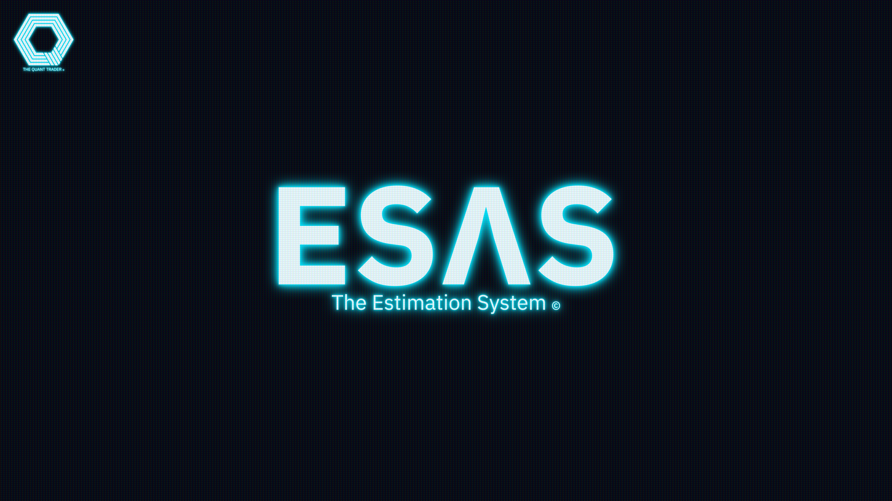

# ESΛS

## Overview

ESYS (The Estimation System) is a prototype for estimating
theoretical option prices on futures. It calculates implied (IV)
and historical (HV) volatility, which are required for
option pricing, and uses them to build a volatility cone
for forecasting. The prototype models the underlying asset price
as geometric Brownian motion in discrete time, with a time step
expressed in fractions of a year. It consists of class modules,
modules, and Excel add-ins (.xlam) that extend Excel's capabilities.

ESYS was developed to test pricing and volatility hypotheses
before moving to a full system implementation.

[Presentation](docs/esys_rev3.pdf)

## License

[BSD-3-Clause](LICENSE)

## Credits

- Denis Khorkin
